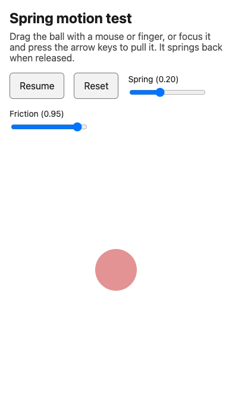

# animation-tests

A small spring-physics experiment: a ball you drag with a mouse, finger or the
keyboard that springs back to where it started. Built with React, TypeScript
(strict) and Vite. The spring is a hand-rolled per-frame integrator
(`src/spring.ts`) and the pointer handling is a custom gesture layer
(`src/gesture.ts`).



## Use it

- **Mouse / touch:** drag the ball and let go.
- **Keyboard:** Tab to the ball, press the arrow keys to pull it (each press pulls
  further, up to a limit); release the key, press Escape or move focus away to let go.
- **Pause / Resume** freezes the ball; **Reset** returns it to its anchor.
- **Spring** and **Friction** sliders tune the physics live.
- With `prefers-reduced-motion: reduce`, the ball snaps straight back instead of
  oscillating.

## Develop

Requires Node 20+.

```sh
npm install
npm run dev        # dev server
npm test           # unit tests (vitest)
npm run typecheck  # tsc --noEmit
npm run build      # typecheck + production build into dist/
npm run preview    # serve the production build
```

The build uses relative asset paths, so `dist/` can be hosted on any static host
or sub-path (for example GitHub Pages).

## License

No license file has been chosen for this repository yet, so all rights are reserved
by default.
